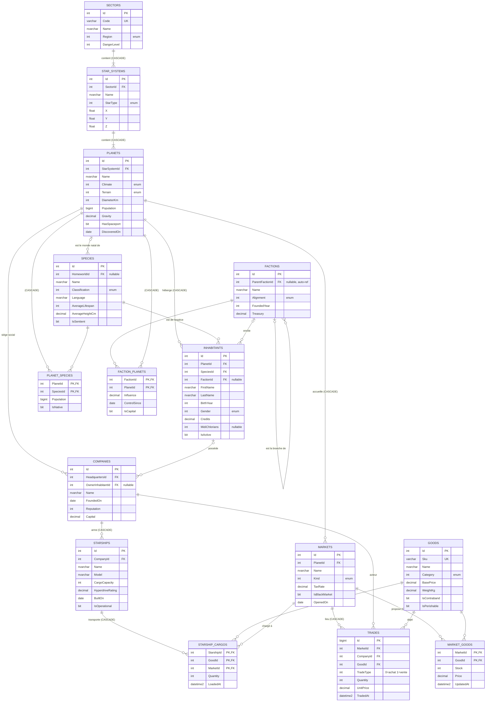

# Étape 01 — Modèle de données « Star Wars Trade »

Jeu vidéo de commerce galactique : des **secteurs** contiennent des **systèmes stellaires**, qui contiennent des **planètes**.
Les planètes abritent des **habitants** de différentes **espèces**, sont disputées par des **factions**, et accueillent des
**marchés** où des **compagnies** commercent des **marchandises** avec leurs **vaisseaux**.

> **Note de notation.** Mermaid n'a pas de losange Merise : les *associations* N-N et ternaires sont donc représentées par leur
> table d'association (qui porte les attributs de l'association). Les cardinalités sont celles du MCD :
> `||` = exactement 1, `o|` = 0 ou 1, `|{` = 1 à N, `o{` = 0 à N.

## 1. MCD

## 2. Les 15 tables et leur rôle pédagogique

| # | Table | Type | Lignes (échelle 1) | Ce qu'elle permet de montrer |
|---|-------|------|-------------------:|------------------------------|
| 1 | `Sectors` | racine | 1 000 000 | Racine de la chaîne de cascade, `Include` profond |
| 2 | `StarSystems` | 1-N | 2 000 000 | Niveau 2 de la hiérarchie |
| 3 | `Planets` | 1-N | 3 000 000 | Pivot du modèle (7 relations entrantes), distribution de `Population` très asymétrique |
| 4 | `Species` | référentiel | 1 000 000 | FK **optionnelle** vers `Planets` (monde natal) |
| 5 | `Factions` | référentiel | 1 000 000 | **Auto-référence** (arbre de factions → CTE récursive, `Include` récursif) |
| 6 | `Inhabitants` | 1-N | 4 000 000 | Table « large », colonnes nullables, tri/pagination, `Select` vs entité complète |
| 7 | `Goods` | référentiel | 1 000 000 | Index unique `Sku`, booléens très sélectifs (`IsContraband` ≈ 8 %) |
| 8 | `Companies` | 1-N | 1 000 000 | Deux FK vers deux hiérarchies différentes |
| 9 | `Starships` | 1-N | 2 000 000 | Cascade `Companies → Starships` |
| 10 | `Markets` | 1-N | 2 000 000 | Cascade `Planets → Markets` |
| 11 | `PlanetSpecies` | **N-N** | 5 000 000 | Many-to-many **avec payload** (`Population`, `IsNative`) |
| 12 | `FactionPlanets` | **N-N** | 2 000 000 | Many-to-many avec payload (`Influence`) |
| 13 | `MarketGoods` | **N-N** | 4 000 000 | Many-to-many avec payload (`Stock`, `Price`) |
| 14 | `Trades` | **ternaire** | 6 000 000 | Journal temporel (Company × Good × Market), clé propre, gros volume → agrégations, keyset pagination, bulk |
| 15 | `StarshipCargos` | **ternaire** | 3 000 000 | Clé primaire composite à **3 colonnes** (Starship × Good × Market) |
| | **Total** | | **38 000 000** | |

## 3. Règles de suppression

| Relation | Comportement | Remarque |
|----------|--------------|----------|
| `Sectors → StarSystems → Planets` | **CASCADE** | supprimer un secteur supprime toute sa descendance |
| `Planets → Inhabitants / Markets / PlanetSpecies / FactionPlanets` | **CASCADE** | |
| `Markets → MarketGoods / Trades` | **CASCADE** | |
| `Companies → Starships → StarshipCargos` | **CASCADE** | |
| Toutes les autres FK (`Species`, `Factions`, `Goods`, `Companies.HeadquartersId`, `Trades.CompanyId`…) | NO ACTION | |

SQL Server interdit qu'une table soit atteignable par **plusieurs chemins de cascade** : c'est pourquoi `Trades` ne cascade que
depuis `Markets` (et pas depuis `Companies`/`Goods`), et `Companies.HeadquartersId` est en `NO ACTION`.
Ce point précis est un très bon sujet de discussion pour la partie EF Core (`OnDelete(DeleteBehavior.…)`, `ClientCascade`).

## 4. Choix de conception

- **Conventions EF Core** : `Id` entier IDENTITY, enums stockés en `int`, tables au pluriel, FK nommées `<Nav>Id`.
  Le modèle pourra donc être scaffoldé (`dotnet ef dbcontext scaffold`) ou écrit à la main sans configuration exotique.
- **Index** : uniquement ceux qu'EF Core créerait par convention (un index par FK) + deux index uniques (`Sectors.Code`, `Goods.Sku`).
  **Aucun index de performance** n'est ajouté : c'est justement ce qu'on optimisera dans les ateliers.
- **Données déterministes** : le seeder est sans état (la valeur d'une cellule ne dépend que de table/ligne/colonne), donc deux
  exécutions donnent exactement la même base — les temps et les plans d'exécution sont comparables d'une machine à l'autre.
- **Distribution** : `Trades.TradedAt` croît avec l'`Id` (série temporelle sur 3 ans) ; ~30 % des `Inhabitants` n'ont pas de faction,
  ~75 % n'ont pas de `MidiChlorians` ; `IsContraband` ≈ 8 %, `IsBlackMarket` ≈ 6 %. Ces proportions servent aux démonstrations de sélectivité.
